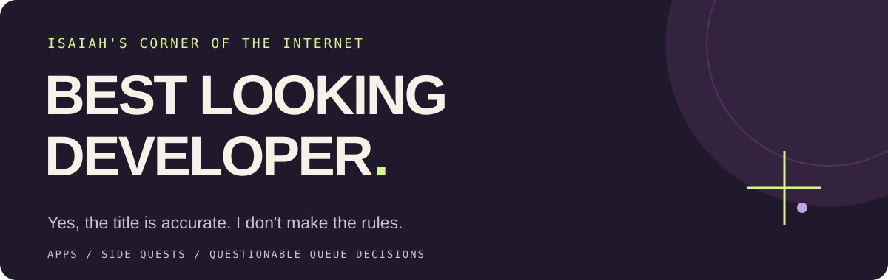
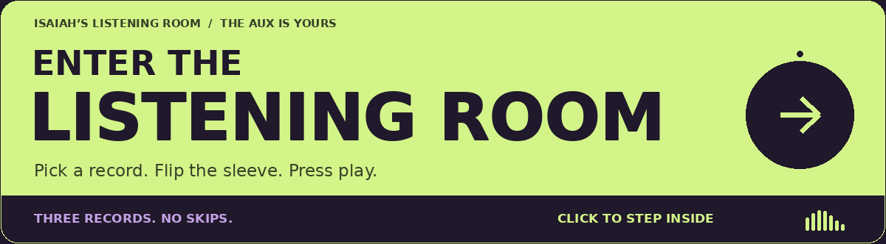
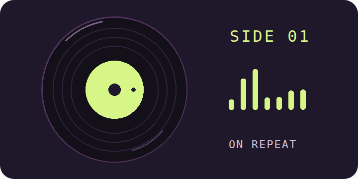
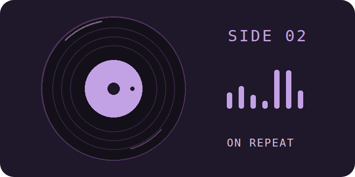
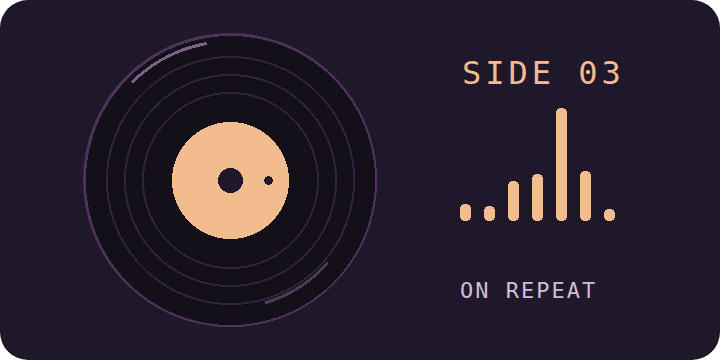

  

I'm **Isaiah**. I build apps, obsess over spacing, and queue jungle like I haven't learned my lesson.

Web, mobile, automation, and the occasional “this would be funny if it actually worked.” I like a little flash, a lot of polish, and software that feels good to use.

[Explore my repos ↗](https://github.com/Parrasite9?tab=repositories)

---

## Things I talked myself into building

### 01 / Studio No. 1
**One salon. A whole roster of independent beauty professionals.**

A shared home for the team, their services, and their booking links. Finding your stylist should not require a side quest.

React · Redux · React Router 
[Take a look at the code ↗](https://github.com/Parrasite9/studiono1)

### 02 / iPhone 15, with a little drama
**An Apple website recreation with 3D and scroll animation.**

A place to play with motion, lighting, and the kind of product presentation that makes you rotate a phone you do not own.

React · Three.js · GSAP 
[Take it apart ↗](https://github.com/Parrasite9/apple3js)

### 03 / Buttons that do more than look good
**My first React + Laravel SCADA project.**

Exploring pump controls over HTTP. A different kind of interface problem: what happens on the other side of the button?

React · TypeScript · Laravel 
[Look under the hood ↗](https://github.com/Parrasite9/reactLaravelSCADAProject)

---

## Currently in rotation

**The unofficial office soundtrack.** Three tracks. Please respect the queue.

<a href="https://parrasite9.github.io/Parrasite9/" aria-label="Enter Isaiah’s listening room">
<picture>
  <source media="(prefers-reduced-motion: reduce)" srcset="assets/listening-room-entry.png" />
  
</picture>
</a>

Click a record below to open the room with that track selected.

<table width="100%">
<tr>
<td width="33%" align="center" valign="top">
 
Open in the listening room ↗  
HEADPHONES ON 
<b>Poor Thang</b> 
J. Cole  

</td>
<td width="33%" align="center" valign="top">
 
Open in the listening room ↗  
AFTER HOURS 
<b>Southside</b> 
Ashanti / Lloyd  

</td>
<td width="33%" align="center" valign="top">
 
Open in the listening room ↗  
DO NOT SKIP 
<b>Int’l Players Anthem</b> 
UGK  

</td>
</tr>
</table>

Headphones recommended. Skipping the third track is between you and your conscience.

---

## Away from the editor

**Jungle / support main. Unlicensed team therapist.**

- Tracking enemy jungle.
- Sweeping wards like a professional janitor.
- Watching top lane die **5 times before 10 minutes**.
- Typing **“we scale”** when we absolutely do not.

**A few strongly held opinions**

- Bad spacing is personal.
- A little animation goes a long way. I will still be tempted to add more.
- “One quick side project” is how you end up with six unfinished ideas.

> software should feel alive or what are we even doing

---

## 🧰 Stuff I Build With (and occasionally fight with)

---

## 📊 Evidence That I Actually Push Code

  

---

## 🔝 Contribution Map

---

### ✍️ Random Dev Quote

---

 

**Got a weird idea or something worth building?** [Tell me about it.](mailto:johnsonisaiah13@yahoo.com)

Thanks for stopping by. Ward on your way out.
